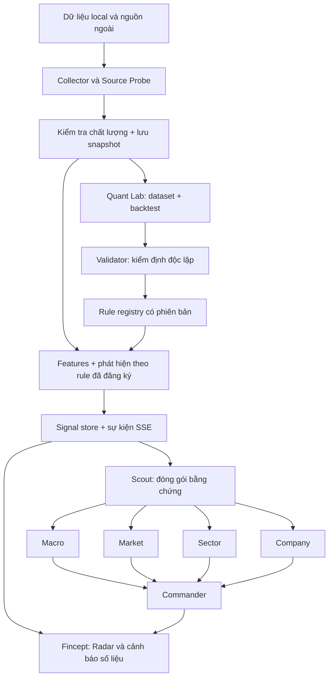

# Third Eyes — kiến trúc đội Agent Military

Ngày thiết kế: 14/09/2026. Trạng thái: đặc tả mở rộng dựa trên mã nguồn hiện có; không phải xác nhận hệ thống đang chạy production hay đã tìm được ngưỡng có hiệu quả đầu tư.

## 1. Tầm nhìn

Third Eyes là hệ thống quan sát liên tục bốn lớp vĩ mô → thị trường → ngành → doanh nghiệp, phát hiện thay đổi sớm và chuyển thành bằng chứng liên quan đến danh mục. Người dùng nhìn thấy: điều gì vừa thay đổi, bất thường đến đâu, tiền lệ lịch sử là gì, mã nào chịu ảnh hưởng, cần kiểm tra gì tiếp và điều kiện nào khiến nhận định mất hiệu lực.

“God eyes view” là một giao diện hợp nhất cả tín hiệu và điểm mù dữ liệu. Mỗi kết luận phải hiện nguồn, thời điểm công bố, thời điểm nhận, mức độ kiểm định và mâu thuẫn. Thiếu dữ liệu phải xuất hiện trên màn hình.

## 2. Mục đích và nguyên tắc tổ chức

- Thay người dùng theo dõi định kỳ; phát hiện cả rủi ro lẫn cơ hội.
- Ưu tiên sự kiện theo mức liên quan đến danh mục, độ mới, chất lượng bằng chứng và mức độ bất thường.
- Tái sử dụng Swarm preset của VibeTrading: `agents`, `tasks`, `depends_on`, `variables`, loader, trạng thái nhiệm vụ và kho kết quả.
- Dùng bộ tính toán xác định để thu thập, tính indicator, học ngưỡng và backtest. Agent AI diễn giải bằng chứng, đề xuất giả thuyết nghiên cứu và phản biện.
- Quyết định danh mục thuộc người dùng. Đầu ra hỗ trợ quyết định gồm kịch bản và điều kiện kiểm tra; việc bổ sung đề xuất hành động có cấu trúc là một hạng mục riêng vì executor hiện tại chỉ cho phép cảnh báo và bằng chứng.
- Môi trường hiện tại: license Silver và có `vnstock_data` trong home venv. Ưu tiên thư viện sponsored được cấp quyền; thiết kế này không phụ thuộc `vnstock_pipeline`. Trước khi thêm adapter phải kiểm tra phiên bản, `show_api()` và `show_doc()` trong môi trường thực thi tương ứng.

## 3. Nền đã có và khoảng cách với tầm nhìn

Các nhận xét sau dựa trên kiểm tra mã nguồn, chưa phải kiểm chứng hoạt động nguồn dữ liệu trực tiếp trong lần thiết kế này.

| Thành phần | Hiện có | Cần mở rộng |
|---|---|---|
| Swarm | `third_eyes_watch`: scout, macro, market, sector, company, commander; `third_eyes_research` thêm validator | Đặc tả domain sâu hơn, thêm vòng đề xuất giả thuyết → chạy nghiên cứu → phản biện |
| Thu thập | Collector, scheduler, coverage, SQLite, snapshot, watchlist/danh mục | Inventory toàn bộ dữ liệu local, registry năng lực nguồn, thử query có giới hạn và quản lý schema |
| Phát hiện | Threshold phân vị, trend độ dốc 5 quan sát, pattern sai phân bậc hai | Chuyển chế độ, phân kỳ, chuỗi sự kiện, chuẩn hóa mùa vụ và đặc tính từng ngành |
| Backtest | Quy tắc cố định, CSV đầu vào, 3 cửa sổ ngoài mẫu, embargo, bootstrap | Tự xây dataset đúng thời điểm, quản lý nhiều giả thuyết, holdout và nhãn sự kiện cho lead time |
| Nghiên cứu tự động | Job định kỳ chạy các CSV được cấu hình | Chưa có vòng tự tìm nguồn, tự xây dataset và tự khám phá quy tắc hoàn chỉnh |
| AI | Ollama local, evidence JSON, DAG, kiểm tra ID bằng chứng, một worker | Chọn agent theo domain, gói bằng chứng có giới hạn, kiểm tra số liệu trong lời giải thích |
| Danh mục | Gắn trực tiếp tín hiệu doanh nghiệp với vị thế cùng mã | Bản đồ tác động vĩ mô/ngành, tránh cộng trùng exposure và sự kiện |
| Terminal | HTTP API, SSE, dashboard riêng, client TypeScript | Tích hợp UI trong checkout Fincept thực tế, kiểm thử vòng đời kết nối và đồng bộ |

Tham chiếu: [vận hành](third-eyes.md), [executor](../agent/src/third_eyes/agents.py), [service](../agent/src/third_eyes/service.py), [backtest](../agent/src/third_eyes/research.py), [models](../agent/src/third_eyes/models.py).

## 4. Đội hình và đặc tả agent

Các mô tả kinh nghiệm là tiêu chuẩn vai trò trong prompt, không phải chứng nhận năng lực thực tế của model.

| Agent / đơn vị | Role | Task và trách nhiệm | Output |
|---|---|---|---|
| Scout — trinh sát dữ liệu | Chuyên gia dữ liệu tài chính | Kiểm kê indicator đã có; xem lịch sử, đơn vị, tần suất, độ trễ, chất lượng; yêu cầu source probe nếu thiếu | Bảng coverage, khoảng thiếu, nguồn ứng viên, kết quả query và lỗi schema |
| Macro — vĩ mô | Chuyên gia vĩ mô Việt Nam/quốc tế, đọc cơ chế và ý chí điều hành | Theo dõi lạm phát, tăng trưởng, tín dụng, lãi suất, thanh khoản, tỷ giá; đối chiếu tuyên bố chính thức với hành động; đề xuất giả thuyết kênh truyền dẫn | Bảng threshold/trend/pattern, chế độ vĩ mô, ngành chịu tác động, bằng chứng chính sách và giả thuyết cạnh tranh |
| Market — thị trường | Chuyên gia thị trường và data science theo chuẩn kinh nghiệm trên 10 năm | Phân tích giá, độ rộng, thanh khoản, biến động, mức tập trung, dòng tiền; tìm phân kỳ; kiểm tra tác động cấu trúc phiên | Bảng tín hiệu thị trường, mức lan tỏa, xác nhận/phủ định giữa các nhóm chỉ báo |
| Sector — ngành | Chuyên gia chu kỳ ngành và phân bổ vốn | So sức mạnh tương đối, độ rộng nội ngành, tỷ trọng thanh khoản, biên đầu vào/đầu ra; phân biệt một mã kéo ngành với lan tỏa; dùng thành phần ngành đúng thời điểm | Bảng xếp hạng ngành, luân chuyển, catalyst, phản chứng và các mã danh mục liên quan |
| Company — doanh nghiệp | Chuyên gia doanh nghiệp và chất lượng lợi nhuận | Theo dõi giá/khối lượng, doanh thu, biên, CFO, nợ, công bố; tách lợi nhuận bất thường; áp dụng bộ chỉ tiêu theo loại hình kinh doanh | Bảng tín hiệu từng mã, thay đổi luận điểm đầu tư, sự kiện, dữ liệu cần xác minh |
| Validator — kiểm định độc lập | Chuyên gia thống kê và phản biện | Kiểm tra look-ahead, vintage, survivorship, số sự kiện, ngoài mẫu, thử nhiều giả thuyết, độ ổn định; phản biện diễn giải nhân quả | Kết luận đạt/chưa đủ/bác bỏ, lý do, hồ sơ kiểm định và điều kiện nghiên cứu lại |
| Commander — tổng hợp danh mục | Chuyên gia tổng hợp rủi ro danh mục | Gom sự kiện trùng, liên kết bốn lớp, xác định exposure và mâu thuẫn, sắp thứ tự cần chú ý | Bản tin ưu tiên, bảng bằng chứng, kịch bản và câu hỏi người dùng cần xem xét |

Quant Lab và Source Probe là dịch vụ tính toán/thu thập dùng chung, không cần thêm một LLM cho từng phép tính. Bốn chuyên gia chịu trách nhiệm phát hiện khoảng thiếu trong domain của mình; Scout hợp nhất để tránh gọi trùng nguồn.

Company dùng template ngân hàng riêng: NIM, NPL, CASA, dự phòng, CAR khi nguồn có; doanh nghiệp phi tài chính dùng biên, vốn lưu động, CFO, đòn bẩy. Không ép một bộ ratio cho mọi ngành.

## 5. Kiến trúc vận hành

Hai preset giữ tên hiện tại để tương thích:

1. `third_eyes_watch`: chạy khi có sự kiện mới hoặc thay đổi đáng kể. Scout → chuyên gia liên quan → Commander. Bản hiện tại gọi đủ bốn chuyên gia; chọn domain là bước nâng cấp.
2. `third_eyes_research`: chạy theo lịch hoặc khi phát hiện khoảng thiếu. Chuyên gia đề xuất giả thuyết → Quant Lab tính toán → Validator phản biện → lưu bản nghiên cứu và rule ứng viên. Đây là luồng đích; preset hiện tại chỉ diễn giải gói bằng chứng đã cấp, không tự chạy toàn bộ vòng này.

Source Probe nhận yêu cầu có schema: indicator cần tìm, nguồn ưu tiên, độ dài lịch sử, ngày công bố cần có, đơn vị và giới hạn số request. Trả `available / missing / unavailable / stale / schema_mismatch / insufficient_history` trong registry đề xuất. Các giá trị này cần ánh xạ sang coverage runtime, không tự coi là enum đã hỗ trợ.

LLM không nằm trên đường phát cảnh báo số liệu. Lỗi model phải hiện `ai_status=failed` trong khi dữ liệu và signal vẫn phục vụ được. Bản hiện tại chạy một worker local; sơ đồ nhánh thể hiện quan hệ nhiệm vụ, không cam kết thực thi AI song song.

## 6. Indicator và giả thuyết nghiên cứu ban đầu

Bảng dưới là backlog nghiên cứu, không phải danh sách đã query thành công hay ngưỡng đã backtest đạt.

| Domain | Nhóm indicator | Threshold ứng viên | Trend ứng viên | Pattern ứng viên |
|---|---|---|---|---|
| Vĩ mô | CPI, tín dụng, IIP, bán lẻ, tỷ giá, lãi suất, OMO | Phân vị thay đổi, z-score sau xử lý mùa vụ | Gia tốc/giảm tốc nhiều kỳ | Tỷ giá chịu áp lực đồng thời thanh khoản co lại; nới lỏng sau giảm tốc |
| Thị trường | Lợi suất, breadth, GTGD, volatility, dòng tiền | Phân vị lợi suất/biến động; khối lượng so cùng thời điểm phiên | Độ rộng và thanh khoản cải thiện/suy giảm | Chỉ số tăng nhưng breadth giảm; biến động tăng cùng mất thanh khoản |
| Ngành | Relative strength, breadth, thanh khoản, input/output spread | Phân vị sức mạnh tương đối và chênh lệch giá | Xếp hạng ngành cải thiện bền vững | Luân chuyển có lan tỏa; giá đầu vào tăng nhanh hơn đầu ra |
| Doanh nghiệp | Giá, volume, doanh thu, lợi nhuận, CFO, nợ, công bố | Bất thường theo lịch sử riêng và nhóm so sánh | Biên/CFO/chất lượng lợi nhuận nhiều quý | Lợi nhuận tăng nhưng CFO yếu; công bố mới đồng thời volume bất thường |

Mỗi giả thuyết phải nêu biến đích: lợi suất, drawdown hay sự kiện rủi ro; horizon tính theo phiên/kỳ rõ ràng. Một chỉ báo tăng cao không tự động có nghĩa là rủi ro, và bất thường thống kê chưa đồng nghĩa có sức dự báo.

## 7. Chuẩn nghiên cứu và backtest

1. Đăng ký giả thuyết, biến đích, phép biến đổi, hướng và horizon trước khi đọc kết quả ngoài mẫu.
2. Lưu riêng kỳ dữ liệu, thời điểm công bố, thời điểm tiếp nhận, revision. Dataset nghiên cứu chỉ dùng thông tin biết được tại thời điểm quyết định. Chuỗi vĩ mô công bố tháng không được nhân thành hàng trăm sự kiện độc lập khi forward-fill theo ngày.
3. Tính ngưỡng từ quá khứ, loại quan sát đang kiểm tra. Dữ liệu intraday chuẩn hóa theo thời điểm trong phiên; giá điều chỉnh và universe lịch sử cần audit riêng.
4. Tách giai đoạn tìm tham số, kiểm định cuốn chiếu và holdout cuối. Purge/embargo theo độ dài nhãn; ghi lại tất cả biến thể đã thử và xử lý multiple testing trước khi nâng cấp rule.
5. Báo số sự kiện độc lập, kết quả theo từng cửa sổ, khoảng tin cậy, phân phối lợi suất, drawdown và tỷ lệ cảnh báo không đạt mục tiêu. Nếu mô phỏng hành động đầu tư thì bổ sung phí, trượt giá, thanh khoản và quy tắc khớp lệnh.
6. Lead time cần nhãn thời điểm sự kiện độc lập; không lấy horizon thay cho độ sớm. Tỷ lệ outcome không dương mà code hiện gọi `false_positive_rate` cần hiển thị đúng nghĩa; đó không tự động là FPR theo ma trận phân loại.
7. Rule có version, dấu vết dữ liệu và trạng thái `candidate → shadow → validated → retired` trong registry đích. Giám sát drift; mất chất lượng thì hạ mức xác nhận và giữ lịch sử lý do.

Gate hiện có yêu cầu ít nhất 30 sự kiện, 3 cửa sổ có sự kiện, cận dưới CI cải thiện > 0 và audit hợp lệ; nâng Priority còn cần tín hiệu xác nhận khác nhóm. Đây là điều kiện kỹ thuật hiện hành, không phải bảo đảm thống kê phổ quát. Với vĩ mô ít sự kiện, chấp nhận giữ Radar lâu hơn thay vì nới tiêu chuẩn để có cảnh báo đẹp.

## 8. Output chuẩn cho Intelligent Dashboard

Mỗi hàng tương ứng một signal/rule/đối tượng. UI có thể gộp để đọc nhưng phải giữ các rule và evidence gốc.

| Nhóm trường | Nội dung |
|---|---|
| Định danh | Signal ID, domain, indicator, entity, rule ID/version |
| Dữ liệu | Giá trị gốc, đơn vị, feature thực sự đem so, đơn vị feature |
| Threshold | Ngưỡng, phương pháp, cửa sổ lịch sử, phía vượt ngưỡng |
| Trend | Hướng, độ dốc, khoảng đo và độ bền |
| Pattern | Mã pattern, điều kiện cấu thành, thời điểm bắt đầu, trạng thái |
| Kiểm định | Candidate/validated, số sự kiện, horizon, kết quả ngoài mẫu, CI, giới hạn |
| Thời gian | Observed, published, received, detected, tuổi dữ liệu và thời điểm AI hoàn tất |
| Bằng chứng | Source, snapshot, liên kết công bố, mâu thuẫn và khoảng thiếu |
| Danh mục | Mã/ngành chịu ảnh hưởng, tỷ trọng có ngày chốt, direct/indirect/context |
| Xử lý | Radar/Priority, risk/opportunity/mixed, đã xem, cập nhật/hết hiệu lực |

`Signal` hiện có phần lớn trường cốt lõi, gồm `feature_value` và `threshold_unit`; cần đồng bộ client TypeScript để biểu diễn đầy đủ. Các trường mới phải bổ sung có version, không thay API âm thầm. LLM output là phần giải thích gắn signal; bảng định lượng lấy từ signal store để tránh model sửa số.

Thiết kế màn hình Fincept: bốn ô tình trạng domain; bảng Radar/Priority; hàng coverage và heartbeat; panel chi tiết gồm threshold/trend/pattern, lịch sử bằng chứng, backtest, ảnh hưởng danh mục và phản chứng. Khi thiếu dữ liệu, hiện trạng thái thiếu ngay cạnh domain.

## 9. Realtime và độ trễ

Thiết kế cập nhật theo nhịp của nguồn. Intraday, tin và báo cáo quý có lịch công bố khác nhau.

| Luồng | Mục tiêu thiết kế | Giới hạn hiện tại |
|---|---|---|
| Giá/volume danh mục | Poll mỗi 60 giây khi nguồn hỗ trợ | Bar 1 phút không phải tick streaming; cadence không bảo đảm độ trễ |
| Thị trường/ngành | Poll 1–5 phút cho dữ liệu thực sự intraday; tính EOD sau đóng bar | Default chỉ số dùng bar ngày; không được gọi kết quả này là chỉ báo intraday |
| Tin/công bố | Kiểm tra mỗi 5 phút; xử lý theo event ID | Phụ thuộc thời điểm nhà cung cấp đăng tải |
| Vĩ mô/fundamental | Theo lịch công bố; kiểm tra ngày, tăng nhịp quanh lịch khi nguồn cho phép | Không tạo thêm thông tin bằng cách poll quá nhanh |
| AI | Gọi khi signal mới hoặc thay đổi đáng kể | Batch mặc định 300 giây, một worker, tối đa 600 giây/nhiệm vụ; cả DAG có thể lâu hơn nhiều |
| Dashboard | Nhận sự kiện sau commit, tiếp tục từ cursor khi kết nối lại | Cần đo trên Fincept thật và xác minh không mất/trùng sự kiện |

Đo riêng `received - published`, `detected - received`, thời gian nhận tại client và độ trễ giải thích AI. Mục tiêu nội bộ đề xuất cho MVP là p95 từ nhận dữ liệu đến phát signal dưới 10 giây ở universe thử nghiệm; phải benchmark mới coi là đạt. Theo dõi queue age, timeout, rate limit, reconnect, duplicate, lịch nghỉ và máy ngủ. Muốn giám sát liên tục phải có tiến trình trên máy luôn bật và cơ chế tự phục hồi.

## 10. Plan xây dựng và tiêu chí hoàn thành

| Giai đoạn | Công việc và file liên quan | Điều kiện hoàn thành |
|---|---|---|
| P0 — chốt nền | Audit `defaults.py`, collector, dữ liệu local, cấu hình và hai preset | Ma trận indicator có nguồn/schema/lịch sử/độ trễ; mọi trạng thái đã xác minh có ngày kiểm tra; biết nguồn nào còn thiếu |
| P1 — quan sát ổn định | Source registry/probe, chuẩn timestamp, retry/backoff, chống trùng, freshness trong `collectors.py`, `service.py`, `store.py` | Một mẫu mỗi domain chạy được hoặc báo thiếu rõ; restart không mất sự kiện; lỗi nguồn không làm dừng nguồn khác |
| P2 — Quant Lab | Dataset builder, feature registry, event labels, walk-forward và registry rule | Có báo cáo tái lập từng rule; không look-ahead; kết quả synthetic tách khỏi dữ liệu thật; rule chưa đạt giữ candidate |
| P3 — đội Swarm | Bổ sung prompt domain, hypothesis contract, validator, Commander; executor chọn domain | Báo cáo có evidence hợp lệ, không sửa số, lỗi upstream hiện rõ, AI chậm không chặn signal |
| P4 — Fincept | Đồng bộ TypeScript contract, tích hợp HTTP/SSE và UI trong repo đích | Hiện đủ bốn domain; xem evidence/backtest; ack; reconnect/replay; kiểm thử token và kết nối desktop |
| P5 — chạy shadow | Quan sát tối thiểu 20 phiên và lịch công bố phù hợp từng domain | Báo coverage, độ trễ, sự kiện trùng/sót, cảnh báo hữu ích, chi phí tài nguyên; quyết định mở rộng dựa trên số đo |

Thứ tự ưu tiên: thị trường và mã danh mục để kiểm chứng đường truyền dữ liệu; bổ sung ngành; mở rộng macro có lịch sử đủ tốt. Cả bốn agent được đặc tả ngay từ đầu, nhưng độ phủ thực tế hiển thị theo nguồn đã xác minh.

20 phiên là thử nghiệm vận hành, không đủ chứng minh sức dự báo vĩ mô hay báo cáo quý. Mốc triển khai UI thật phụ thuộc vị trí/version checkout Fincept; chưa được xác định trong lần thiết kế này.

## 11. Phạm vi bản bàn giao này

Đã đọc cấu trúc preset Swarm, executor, model dữ liệu, service, backtest và client hiện có để lập đặc tả này. Giữ nguyên các thay đổi đang có của người dùng. Chưa khởi chạy monitor, chưa gọi nguồn live, chưa tìm ngưỡng từ dữ liệu thật, chưa sửa Fincept và chưa chứng nhận vận hành liên tục. Đây là bản thiết kế và backlog triển khai nối tiếp nền Third Eyes hiện hữu.

## 12. Cập nhật triển khai P1/P2 ngày 14/09/2026

P1 đã bổ sung freshness EOD và intraday theo phiên/lịch nghỉ cấu hình, retry/backoff/jitter, circuit breaker lỗi liên tiếp, queue-age bền trong store và rotating log. Với feed bar một phút hiện tại, `session_final_bar_close=14:46` Asia/Bangkok là contract quan sát được của nhà cung cấp; sau giờ này freshness dựa trên bar cuối phiên thay vì tuổi tường tuyệt đối. Lịch nghỉ 2026 trong cấu hình local theo thông báo HNX, gồm cập nhật nghỉ thêm 02/01. Test mô phỏng mất mạng, cooldown, job-store restart, lease và SSE cursor; đây chưa phải soak/restart tiến trình production. Live verification một lần đã đạt 12/12 source FPT/HPG/MWG và coverage vẫn giữ qua khởi động lại CLI; không monitor hoặc AI nào được bật.

Ngày 15/09/2026, gap CPI/DXY/Fed/company-disclosure được thay bằng source thật. CPI đọc bài công bố tháng từ API chính thức `nso.gov.vn`, trích CPI YoY theo schema khóa và giữ ngày công bố; DXY/Fed đi qua Unified UI `Macro.global`; disclosure tổng hợp hợp nhất ba ticker trong watchlist nhưng chỉ ghi coverage để không nhân đôi signal từng mã. UAT 75 giây và restart 15 giây chạy trong `.third-eyes-uat`, không AI/API/token: bốn source available, heartbeat/job store/lease giữ đúng và queue age tối đa 0,33 giây. Lệnh `soak` luôn từ chối state directory production.

P2 đã có `datasets.py` để as-of join Observation với lịch target, nhãn 1/5/20 phiên, `event_eligible`, manifest/hash và phân tách synthetic. SQLite có feature registry, certificate store, rule lifecycle và transition history. Backtest hỗ trợ protocol nhiều biến thể với Bonferroni. Mọi rule hiện vẫn `candidate`; chưa có research CSV point-in-time thật hoặc certificate đủ điều kiện. Không phần nào của cập nhật này bật monitor production, gọi Swarm thật hay tích hợp Fincept.

## 13. Cập nhật P3 UAT ngày 15/09/2026

Executor Third Eyes nạp nội dung immutable snapshot vào evidence pack thay vì chỉ chuyển
snapshot ID. DAG được route theo domain: luôn có trinh sát dữ liệu và Commander, nhưng chỉ
gọi chuyên gia của các domain thực sự xuất hiện trong batch. Domain không hỗ trợ bị từ chối
rõ ràng. Narration chạy thành batch riêng; timeout/lỗi model chỉ cập nhật `ai_status=failed`,
không xóa, expire hoặc chặn signal định lượng.

UAT Ollama thật ban đầu với signal giả lập company/FPT chạy ba lần gọi LLM qua
`scout → company → commander` trong 315,733 giây. Benchmark macro tương tự mất 297,065 giây,
cho thấy context 4K và giới hạn output không xử lý được nút thắt sinh token trên CPU. Thiết kế
được tối ưu để Scout kiểm tra sự tồn tại/allowlist evidence bằng code deterministic, chuyên gia
domain là lần gọi LLM duy nhất, và Commander hợp nhất nguyên trạng report đã kiểm tra. Cách này
không loại bỏ node hay dấu vết DAG nhưng tránh hai lần diễn giải lại cùng số liệu.

Ma trận UAT tối ưu đạt company 89,530 giây, macro 91,088 giây, market 90,744 giây và sector
93,347 giây. Thời gian Scout/Commander mỗi node chỉ 1–2 ms; phần còn lại là inference của
chuyên gia domain. Output tiếng Việt, chỉ dùng signal/snapshot ID trong allowlist và giữ giới
hạn không dùng dữ liệu UAT để đầu tư. Đây là bằng chứng đạt Gate 4 về chức năng và baseline
latency local; không phải chứng nhận rule, SLA production hoặc cho phép go-live. Collector
shadow P1/P2 tiếp tục chạy độc lập, không API/AI/token; Fincept chưa được tích hợp.
